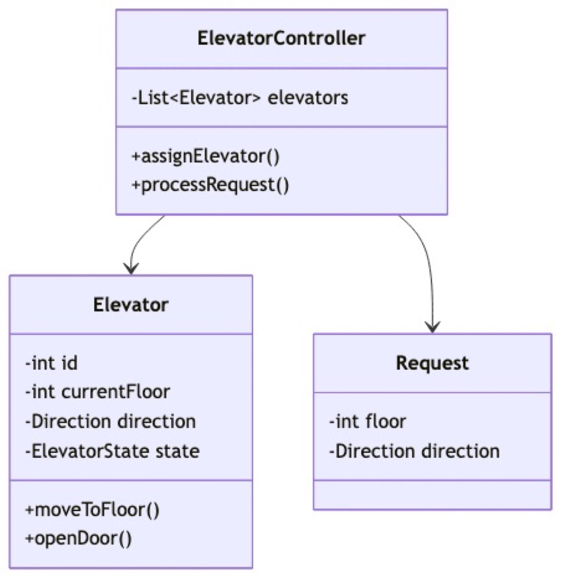

# Elevator System - Complete LLD Guide

## Table of Contents
1. [Problem Statement](#problem-statement)
2. [Requirements](#requirements)
3. [System Design](#system-design)
4. [Class Diagram](#class-diagram)
5. [Implementation Approaches](#implementation-approaches)
6. [Design Patterns Used](#design-patterns-used)
7. [Complete Implementation](#complete-implementation)

---

## Problem Statement

Design an **Elevator System** for a multi-story building that efficiently handles passenger requests, optimizes travel time, manages multiple elevators, and implements various dispatch algorithms (FCFS, SCAN, LOOK, Shortest Seek Time First).

### Key Challenges
- **Request Optimization**: Minimize wait time and travel distance
- **Direction Management**: Serve requests in current direction first
- **Load Balancing**: Distribute requests across multiple elevators
- ⏱ **Real-Time Updates**: Track current floor, direction, capacity
- **Door Management**: Open/close timing, safety sensors
- **Concurrency**: Handle multiple simultaneous requests
- **Dispatch Algorithms**: FCFS, SCAN, LOOK, SSTF

---

## Requirements

### Functional Requirements

- **Elevator Control**
- Move up/down to target floor
- Stop at requested floors
- Open/close doors
- Emergency stop

- **Request Handling**
- **External requests**: Floor button (up/down direction)
- **Internal requests**: Elevator panel button (destination floor)
- Queue management for pending requests
- Priority handling (emergency, VIP)

- **Dispatch Algorithms**
- **FCFS** (First Come First Served): Serve in order
- **SCAN** (Elevator Algorithm): Go to top, then bottom
- **LOOK**: Like SCAN but reverse at last request
- **SSTF** (Shortest Seek Time First): Serve nearest request

- **State Management**
- Track current floor, direction (UP/DOWN/IDLE)
- Door state (OPEN/CLOSED)
- Capacity (max passengers/weight)
- Elevator status (ACTIVE, MAINTENANCE, OUT_OF_SERVICE)

- **Multi-Elevator Coordination**
- Assign requests to optimal elevator
- Load balancing across elevators
- Handle elevator failures gracefully

### Non-Functional Requirements

- **Performance**: Average wait time < 30 seconds
- **Safety**: Door sensors, weight limits, emergency stops
- **Scalability**: Support 10+ elevators, 100+ floors
- **Reliability**: 99.9% uptime, graceful degradation

---

## System Design

### Elevator State Machine

```
      ┌──────┐
      │ IDLE │
      └───┬──┘
          │ Request received
          ▼
    ┌───────────┐
    │ MOVING │◄────┐
    │ (UP/DOWN)│ │
    └─────┬─────┘ │
          │ │
          │ Reached │
          │ floor │
          ▼ │
    ┌──────────┐ │
    │ STOPPED │ │
    └─────┬────┘ │
          │ │
          ▼ │
    ┌──────────┐ │
    │DOOR_OPEN │ │
    └─────┬────┘ │
          │ Timer │
          ▼ │
    ┌───────────┐ │
    │DOOR_CLOSED│─────┘
    └───────────┘ More requests
```

### SCAN Algorithm (Elevator Algorithm)

```
Floor 10: ──────────────────▲
Floor 9: ──────────────────┤
Floor 8: ──────────[R]─────┤ Going UP
Floor 7: ────────────────┐ │
Floor 6: ──────[R]───────┤ │
Floor 5: ────[E]─────────┤ │ (Elevator at 5)
Floor 4: ──────────────┐ │ │
Floor 3: ────────────┐ │ │ │
Floor 2: ──[R]───────┤ │ │ │ Going DOWN
Floor 1: ────────────┤ │ │ │
Floor 0: ────────────▼ │ │ │
                        └─┴─┴─┘

Order: 5 → 6 → 8 → 10 → 4 → 3 → 2 → 1
```

---

## Class Diagram



<details>
<parameter name="summary"> View Mermaid Source
