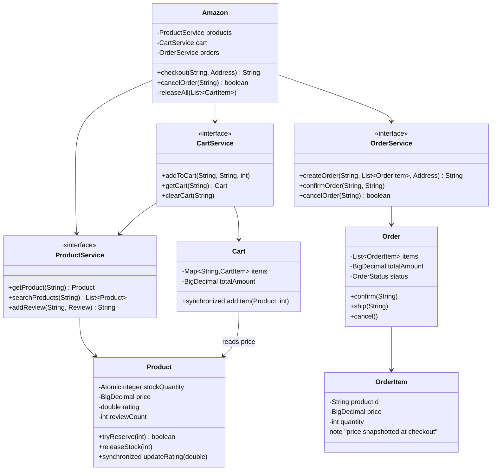
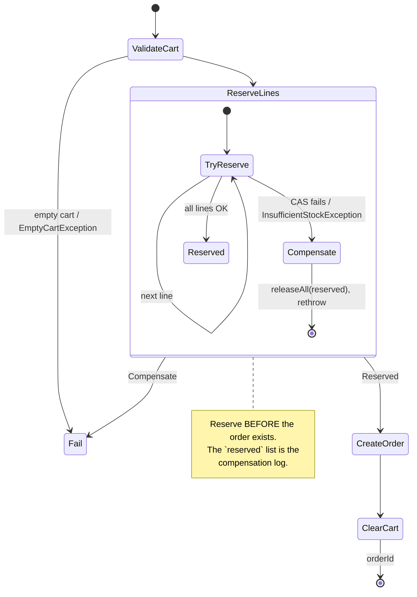
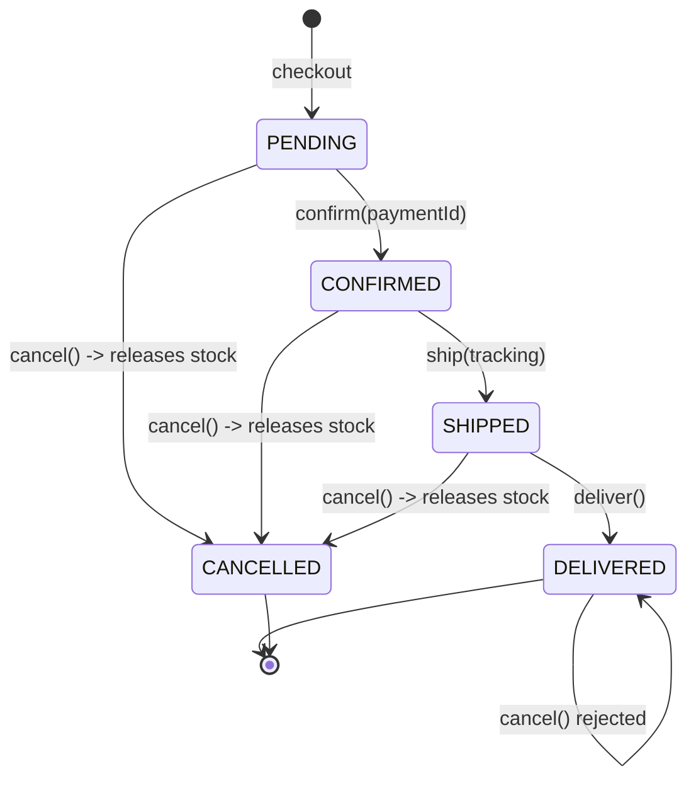

# Amazon E-Commerce — LLD

Design product catalog, shopping cart, checkout, order lifecycle, reviews.

## Package Structure

```
amazon/
  model/          Product, Cart, Order, Review, Address, Payment
  service/        ProductService, CartService, OrderService, PaymentService
  service/impl/   Product/Cart/Order/Payment implementations
  exceptions/     InsufficientStock, EmptyCart, ProductNotFound, OrderNotFound, ...
  Amazon.java     Facade (catalog + cart + checkout saga)
  AmazonDemo.java
```

## Class Diagram



## Checkout Saga (all-or-nothing)



## Order Lifecycle



## Design Patterns

| Pattern | Where | Why |
|---------|-------|-----|
| **Facade** | `Amazon` | Orchestrates the cart → reserve → order saga in one API. |
| **Service decomposition** | Separate cart/order/product services | Single Responsibility; cart doesn't know shipping. |
| **Saga + compensation** | `checkout` / `releaseAll` | All-or-nothing across services without a distributed transaction. |
| **Compare-and-swap** | `Product.tryReserve` | The no-oversell invariant, lock-free. |
| **Value Object** | `OrderItem`, `Address` | Price snapshotted at checkout so orders don't rewrite themselves. |
| **Guarded state transitions** | `Order.confirm/ship/cancel` | Illegal transitions throw rather than corrupt. |

## Run Demo

```bash
mvn -q compile exec:java -Dexec.mainClass="com.you.lld.problems.amazon.AmazonDemo"
```

## Key Talking Points

- **Stock is reserved at checkout, not at add-to-cart.** Reserving earlier holds
  inventory hostage to abandoned carts and needs a TTL + reaper. Checkout-time
  reservation trades that for a late "out of stock" — a product decision worth
  stating explicitly.
- **`tryReserve` is a CAS loop on the entity, not a service method.** A check-then-act
  (`if (q > stock) throw; stock -= q;`) lets every concurrent buyer pass the same
  stale check — measured at 100 orders against 1 unit. Putting the invariant on
  `Product` means no future service can bypass it.
- **Checkout is a saga.** Reserve every line before the order exists; on any
  failure, release everything already reserved and rethrow. `cancelOrder` is the
  symmetric compensation — without it inventory leaks on every cancellation.
- **`synchronized` for the rating, CAS for the stock.** The running average spans
  two fields (`rating`, `reviewCount`) so atomics don't help; stock is one field so
  CAS is strictly better. Picking per field is the point.
- **Order state machine** — PENDING → CONFIRMED → SHIPPED → DELIVERED / CANCELLED,
  with guards on the entity so illegal transitions throw.
- **Services are silent and speak their error vocabulary** — no `System.out` in the
  service layer, and the typed exceptions are actually thrown.

See [INTERVIEW.md](INTERVIEW.md) for the full SDE2/SDE3 walkthrough, including the
measured overselling reproduction.
