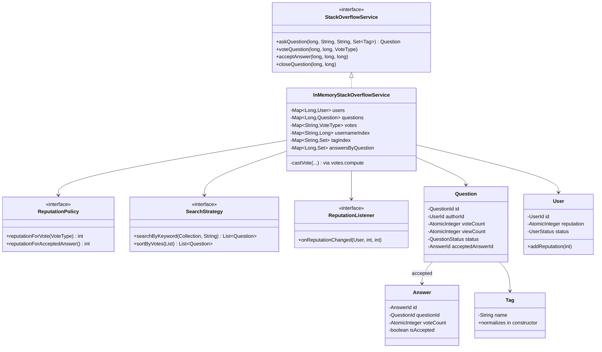
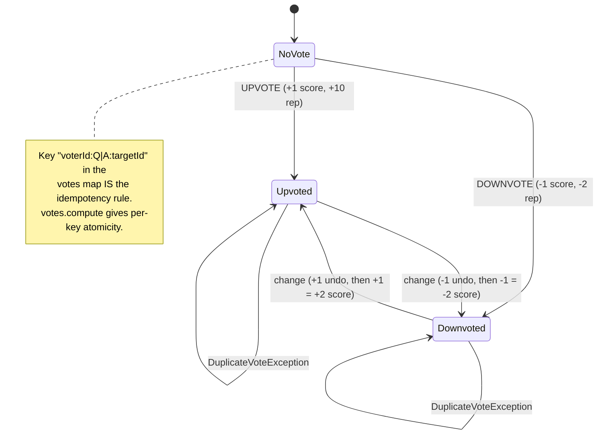

# Stack Overflow (Q&A Platform)

Interview-ready LLD for a Stack Overflow–style Q&A system: users, questions, answers, voting, reputation, search, and acceptance.

## Run

```bash
mvn -q compile exec:java -Dexec.mainClass="com.you.lld.problems.stackoverflow.StackOverflowDemo"
```

## Package structure

```
stackoverflow/
  model/          User, Question, Answer, Tag, VoteType, *Id value objects
  service/        StackOverflowService, ReputationPolicy, SearchStrategy, ReputationListener
  service/impl/   InMemoryStackOverflowService, policies, LoggingReputationListener
  exception/      UserNotFoundException, DuplicateVoteException, SelfVoteException, ...
  StackOverflow.java       Facade
  StackOverflowDemo.java   6-scenario demo
```

## Class Diagram



## Vote State (per voter, per post)



## Patterns

| Pattern | Where | Why |
|---------|-------|-----|
| Aggregate Root | `User`, `Question` | Enforce invariants at domain boundary |
| Value Object | `Tag`, `*Id` | Immutable, equality by value; `Tag` normalizes in its constructor so the index key is canonical |
| Strategy | `SearchStrategy`, `ReputationPolicy` | Swap ranking / rep rules |
| Observer | `ReputationListener` | Badge hooks, notifications |
| Command-ish | private `VoteTarget` callback | `voteQuestion`/`voteAnswer` share one idempotency algorithm |
| Repository (in-memory) | `ConcurrentHashMap` indexes | O(1) lookup by id, username, tag, question→answers |

## Key Talking Points

- **Vote idempotency lives in the key.** `"voterId:Q|A:targetId"` in the `votes`
  map, updated through `votes.compute` — `ConcurrentHashMap` already gives atomic
  read-modify-write per key, so there is no lock object to invent. Changing a vote
  undoes the old delta and applies the new one in the same atomic step.
- **The lock scope and the counter scope are different.** Vote idempotency is per
  *(voter, post)*; the score and reputation are per *post/user*. Distinct voters
  never share a vote lock, so `voteCount` and `reputation` are `AtomicInteger` —
  guarding only the first and leaving `count += delta` plain silently loses votes
  (measured: 22 of 200 lost before the fix).
- **Reputation clamps atomically.** `accumulateAndGet(points, (cur, d) -> max(0, cur + d))`
  — a `getAndAdd` then clamp is two steps and can transiently expose a negative.
- **Listeners fire outside the critical section**, so a slow badge handler can't
  stall unrelated votes.
- **Authorization on every mutating call** — author-only for edit and accept,
  author-or-reputation-privileged for close.
- **Aggregate root** — `Question` owns lifecycle invariants (close blocks answers,
  single accept, accepting a second answer reverses the first's reputation).

See [INTERVIEW.md](INTERVIEW.md) for the full SDE2/SDE3 walkthrough, including the
measured vote-loss, duplicate-username, and authorization reproductions.
