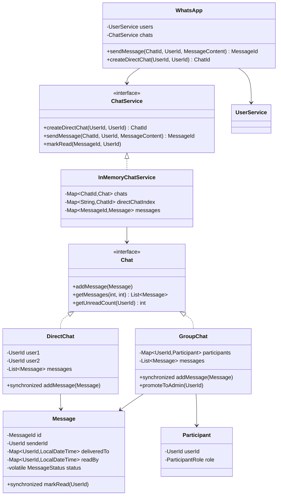
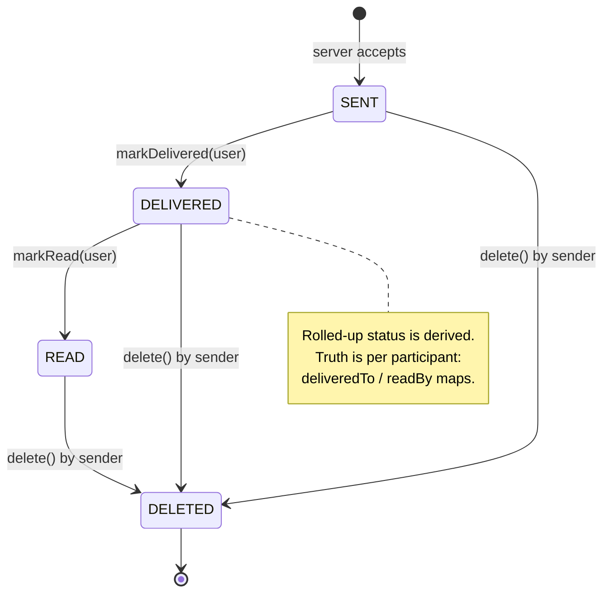

# WhatsApp — LLD

Design messaging: users, direct/group chats, delivery receipts, typing, blocking.

## Package Structure

```
whatsapp/
  model/          User, Message, DirectChat, GroupChat, MessageContent
  service/        UserService, ChatService
  service/impl/   InMemoryUserService, InMemoryChatService
  WhatsApp.java   Facade
  WhatsAppDemo.java
```

## Class Diagram



## Message Status



## Design Patterns

| Pattern | Where | Why |
|---------|-------|-----|
| **Facade** | `WhatsApp` | Bundles user + chat services for demo/interview API. |
| **Composite** | `Chat` hierarchy (Direct/Group) | Uniform send/receive across chat types — no `instanceof` in the service. |
| **Builder** | `Message.Builder` | 3 required + 4 optional fields (reply, forward, type, timestamp). |
| **Value Object** | `UserId`, `ChatId`, `MessageId`, `PhoneNumber` | Typed ids make swapped arguments a compile error. |

## Run Demo

```bash
mvn -q compile exec:java -Dexec.mainClass="com.you.lld.problems.whatsapp.WhatsAppDemo"
```

## Key Talking Points

- **The chat is the lock.** Registries are `ConcurrentHashMap`, but that buys
  nothing for the per-chat message list. Each chat object is its own monitor, so
  sends to one chat serialize while different chats run fully parallel. A plain
  `ArrayList` under that lock beats `CopyOnWriteArrayList` for append-heavy history.
- **Receipts are per participant.** `deliveredTo` / `readBy` are maps, not booleans
  — a group message is delivered *to Bob*, read *by Carol*. The single
  `MessageStatus` is a derived convenience for the sender's tick UI.
- **Direct chat dedup is atomic.** An order-independent pair key plus
  `putIfAbsent` — check-then-act let 32 concurrent callers create 32 chats for one pair.
- **Unread via watermark.** Per-user `lastReadAt` rather than a counter that drifts.
- **Soft delete.** Tombstones keep ordering and receipts coherent ("This message was deleted").

See [INTERVIEW.md](INTERVIEW.md) for the full SDE2/SDE3 walkthrough, including the
measured message-loss and duplicate-chat reproductions.
